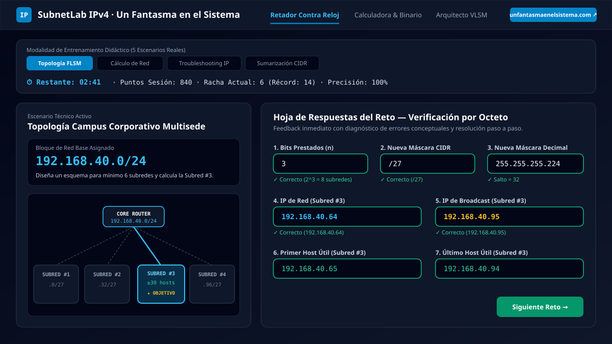
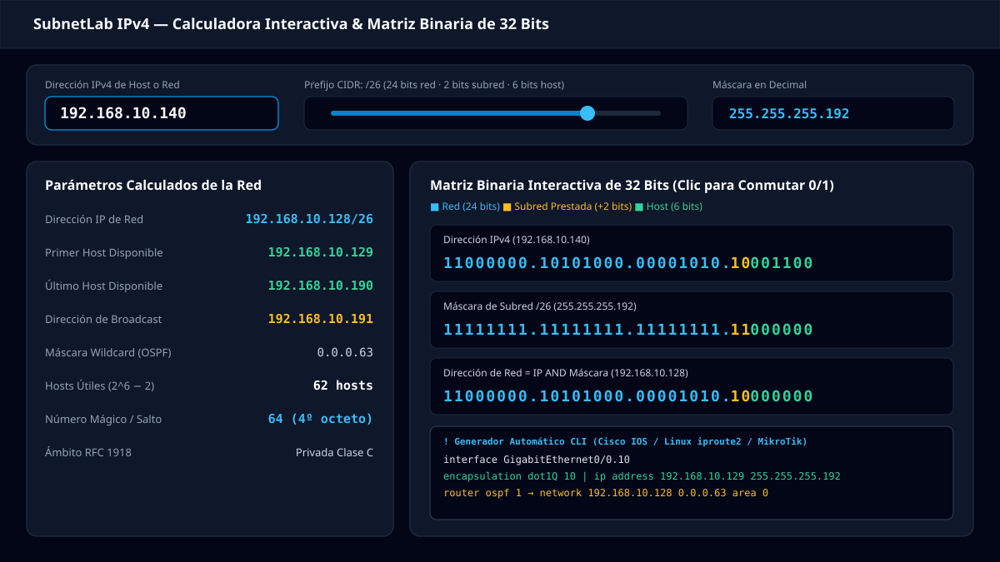
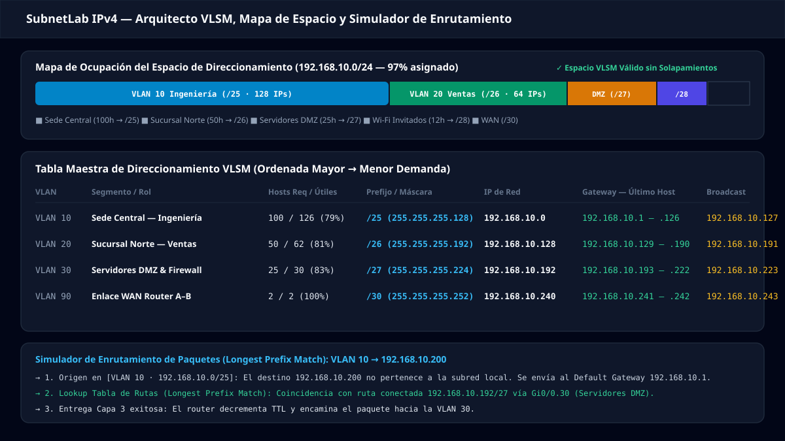

<div align="center">
  <a href="https://www.unfantasmaenelsistema.com/">
    
  </a>

  # SubnetLab IPv4 — Calculadora, Laboratorio Binario y Retador Contra Reloj

  **Entrenador interactivo de subnetting IPv4, diseño de topologías FLSM/VLSM, diagnóstico de incidencias de red y generador de configuraciones CLI reales (Cisco IOS, Linux `iproute2`, MikroTik).**

  Desarrollado para **[Un Fantasma en el Sistema](https://www.unfantasmaenelsistema.com/)** · Preparado para despliegue directo en **GitHub Pages**

  [](https://www.unfantasmaenelsistema.com/)
  [](https://react.dev/)
  [](https://www.typescriptlang.org/)
  [](https://tailwindcss.com/)
  [](https://pages.github.com/)
</div>

---

## Descripción General

**SubnetLab IPv4** es una plataforma web educativa y herramienta de ingeniería de redes diseñada para estudiantes de administración de sistemas y redes (ASIR, SMR, Ingeniería Telemática, certificaciones **Cisco CCNA / CCNP**, CompTIA Network+) y profesionales de infraestructura IT.

Combina un **retador gamificado contra reloj** con un **laboratorio binario bit a bit de 32 bits** y un **arquitecto de subredes VLSM** con simulación de enrutamiento de paquetes en Capa 2 y Capa 3.

---

## Capturas de Pantalla de los Módulos

### 1. Retador Contra Reloj y Diseño para Topologías Dadas
Entrenador con 5 modalidades prácticas, reloj de competición (**Libre**, **60s Blitz**, **3m Sprint**, **5m Examen**), 4 niveles de dificultad CIDR, regla binaria desplegable y corrección inteligente octeto a octeto.



---

### 2. Calculadora Interactiva IPv4, Matriz Binaria de 32 Bits y Generador CLI
Permite conmutar cualquier bit (`0` o `1`) haciendo clic directamente en la matriz de 32 bits, visualizar operaciones `AND` / `OR`, comprobar si dos equipos están en el mismo dominio de broadcast (Capa 2 vs Capa 3) y exportar la configuración lista para **Cisco IOS**, **Linux (`iproute2`)** y **MikroTik RouterOS**.



---

### 3. Arquitecto de Subredes VLSM y Simulador de Enrutamiento (Longest Prefix Match)
Calcula asignaciones óptimas sin solapamiento ordenando de mayor a menor demanda de hosts, dibuja el mapa proporcional de ocupación del bloque IPv4, incluye un **Modo Autoevaluación VLSM**, exporta scripts completos **Router-on-a-Stick (`dot1Q` + DHCP + OSPF)** y simula el flujo de paquetes entre VLANs.



---

## Características Principales

### Retador Contra Reloj (5 Escenarios Reales)
1. **Cálculo Integral de Red**: A partir de una IP y una máscara (en notación CIDR o decimal), solicita calcular:
   - Dirección IP de Red (`Network ID`)
   - Dirección IP de Broadcast
   - Primer y último host disponible
   - Conversión entre máscara decimal (`255.255.x.x`) y prefijo CIDR (`/xx`)
   - Máscara en binario de 32 bits (con selector rápido por octetos o entrada manual)
   - Total de hosts útiles ($2^h - 2$)
2. **Subredes para Topología FLSM Dada**: Presenta un diagrama lógico con un router central y múltiples ramas/VLANs, pidiendo calcular los bits prestados ($n$), la nueva máscara CIDR y decimal, el número total de subredes creadas ($2^n$), los hosts por subred y el rango exacto de la subred objetivo marcada en el esquema.
3. **Troubleshooting & Diagnóstico IP**: Simula tickets de soporte reales donde una estación de trabajo no alcanza a su *Default Gateway*, debiendo diagnosticar la causa raíz (*IP en otra subred*, *IP de Red asignada al host*, *IP de Broadcast asignada al host* o *máscara incongruente*) y calcular el rango correcto.
4. **Sumarización de Rutas OSPF / BGP (Supernetting)**: Presenta bloques contiguos de subredes con su alineación binaria para calcular la ruta sumarizada óptima (`Superred /CIDR` y máscara decimal).
5. **Sprint Binario & Número Mágico**: Entrenamiento rápido centrado en calcular el salto de bloque (`256 − máscara`), conversión binaria y límites de red en segundos.

### Laboratorio Bitwise y Herramientas Profesionales
- **Matriz Interactiva de 32 Bits**: Cada bit de los 4 octetos es un botón interactivo codificado por color y leyenda explícita (**Red**, **Subred prestada**, **Host**).
- **Verificador de Conectividad Capa 2 vs Capa 3**: Compara dos direcciones IP bajo la máscara activa para determinar si se comunican directamente por ARP/Switch o si requieren enrutamiento mediante puerta de enlace.
- **Generador de Comandos CLI Reales**: Genera automáticamente la configuración de subinterfaces VLAN `802.1Q`, pools DHCP y anuncios OSPF con máscara *wildcard* para **Cisco IOS**, **Linux (`iproute2`)** y **MikroTik RouterOS v7**.
- **Exportación de Documentación**: Descarga planes de direccionamiento VLSM en formato **CSV** (Excel/LibreOffice), tablas **Markdown** para documentación técnica e informes de progreso en **JSON**.

---

## Fundamento Didáctico: El Método del Número Mágico (Salto de Bloque)

La aplicación enseña a resolver cualquier problema de subnetting mentalmente en 5 pasos:

| Paso | Operación | Fórmula / Regla | Ejemplo (`192.168.10.140/26`) |
| :--- | :--- | :--- | :--- |
| **01. Octeto Interesante** | Identificar el octeto donde cambia la máscara de `1` a `0` | `/26` = `24 + 2 bits` → **4º octeto** (`192`) | `255.255.255.192` |
| **02. Salto de Bloque** | Restar a `256` el valor decimal del octeto interesante | $\text{Salto} = 256 - \text{Máscara}$ | $256 - 192 = \mathbf{64}$ |
| **03. Dirección de Red** | Mayor múltiplo del salto $\le$ valor de la IP en ese octeto | $\lfloor 140 / 64 \rfloor \times 64 = 128$ | **`192.168.10.128`** |
| **04. Broadcast** | Siguiente subred ($128 + 64 = 192$) menos $1$ | $\text{Broadcast} = \text{Sig\_Red} - 1$ | **`192.168.10.191`** |
| **05. Rango de Hosts** | Primer host = $\text{Red} + 1$ · Último host = $\text{Broadcast} - 1$ | $\text{Hosts} = 2^6 - 2 = 62$ | **`192.168.10.129` — `192.168.10.190`** |

---

## Instalación y Uso Local

### Requisitos previos
- **Node.js** 18+ y **npm**

### Pasos de ejecución

```bash
# 1. Clonar el repositorio
git clone https://github.com/TU_USUARIO/subnetlab-ipv4.git
cd subnetlab-ipv4

# 2. Instalar dependencias
npm install

# 3. Iniciar servidor de desarrollo (puerto 3000)
npm run dev

# 4. Generar compilación estática de producción en ./dist
npm run build
```

---

## Despliegue en GitHub Pages

El proyecto ya incluye:
1. **`base: './'`** configurado en `vite.config.ts` para que todas las rutas de recursos e iconos funcionen en cualquier subruta (`https://usuario.github.io/nombre-repo/`).
2. **Workflow automático de GitHub Actions** en `.github/workflows/deploy.yml`.

### Cómo activar GitHub Pages en tu repositorio:
1. Sube este repositorio a tu cuenta de GitHub (`main` o `master`).
2. En GitHub, entra en **Settings → Pages**.
3. En **Build and deployment → Source**, selecciona **GitHub Actions**.
4. Al hacer push, la acción `.github/workflows/deploy.yml` compilará automáticamente el proyecto con Vite y lo publicará en tu URL de GitHub Pages.

---

## Estructura del Proyecto

```text
├── .github/workflows/
│   └── deploy.yml                  # Despliegue automático en GitHub Pages
├── public/
│   ├── assets/aistudio/
│   │   └── icono_81a3db5b.png      # Logotipo oficial de Un Fantasma en el Sistema
│   └── screenshots/                # Capturas vectoriales de alta resolución para el README
├── src/
│   ├── components/
│   │   ├── ChallengerView.tsx      # Retador contra reloj (5 modos + historial + pistas)
│   │   ├── CalculatorView.tsx      # Calculadora IPv4, matriz 32 bits, L2/L3 y CLI
│   │   ├── VlsmArchitectView.tsx   # Arquitecto VLSM, simulador de paquetes y script Cisco
│   │   └── AcademyView.tsx         # Academia, regla de octeto y tabla CIDR /8 a /32
│   ├── utils/
│   │   └── ipv4.ts                 # Motor matemático 32-bit unsigned, VLSM y generadores
│   ├── App.tsx                     # Navegación principal, tema claro/oscuro y estado
│   ├── index.css                   # Configuración Tailwind CSS v4 y tipografía
│   └── main.tsx                    # Punto de entrada React
├── index.html                      # Metadatos SEO, OpenGraph y fuentes
├── package.json
└── vite.config.ts                  # Configuración Vite con base: './'
```

---

## Autoría y Enlaces

Creado para **[Un Fantasma en el Sistema](https://www.unfantasmaenelsistema.com/)**.
Visita **[https://www.unfantasmaenelsistema.com/](https://www.unfantasmaenelsistema.com/)** para más recursos, artículos técnicos, ciberseguridad, sistemas y redes.
