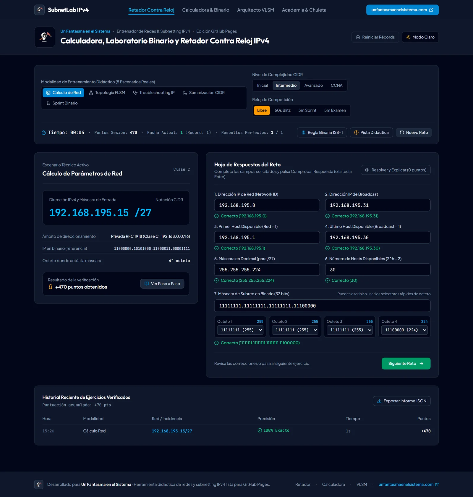
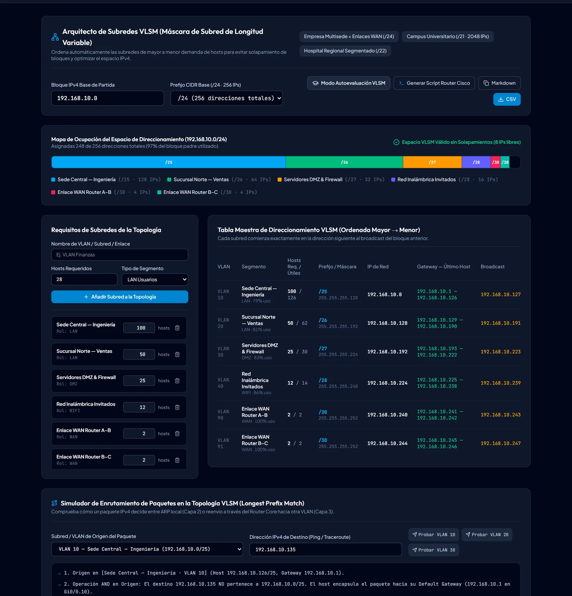
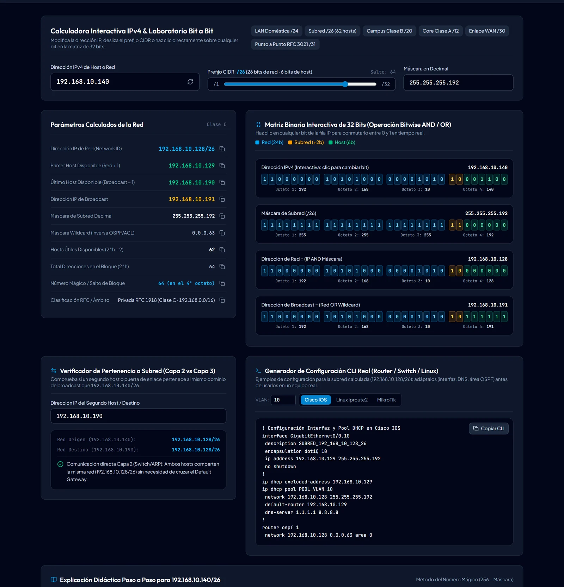
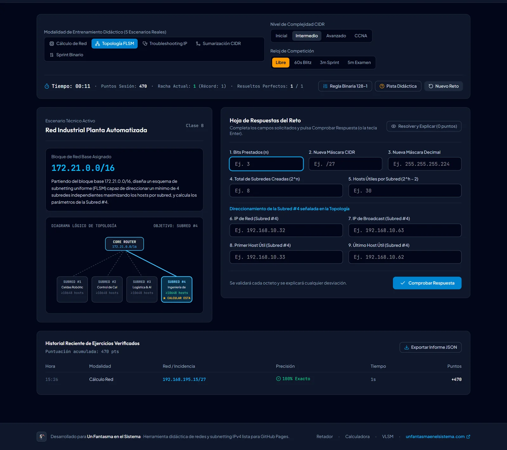

<p align="center">
  <a href="https://www.unfantasmaenelsistema.com"></a>
</p>

<h1 align="center">SubnetLab IPv4</h1>

<p align="center">
  <b>Calculadora, retador contrarreloj y diseñador VLSM de subnetting IPv4</b><br>
  Método del número mágico paso a paso · 5 tipos de reto · Diagnóstico de fallos · Sumarización de rutas · Configuración Cisco, Linux y MikroTik
</p>

<p align="center">
  <a href="https://unfantasmaenelsistema.github.io/SubnetLab-IPv4/"><b>▶ Abrir SubnetLab</b></a> ·
  <a href="#qué-hace">Qué hace</a> ·
  <a href="#el-método-del-número-mágico">Método</a> ·
  <a href="#cómo-puntúa-el-retador">Puntuación</a> ·
  <a href="#desarrollo">Desarrollo</a> ·
  <a href="https://www.unfantasmaenelsistema.com">unfantasmaenelsistema.com</a> ·
  <a href="LICENSE">MIT</a>
</p>

<p align="center">
  
  
  
  
</p>

<p align="center">
  
</p>

Una aplicación para practicar subnetting IPv4 hasta resolverlo de cabeza: calcula cualquier red explicando cada paso, genera retos aleatorios con cinco niveles de dificultad y corrige cada campo diciendo dónde está el error (por ejemplo, «has puesto la IP de red como primer host»). Incluye un diseñador VLSM con simulador de enrutamiento y una chuleta completa de /8 a /32.

> [!NOTE]
> Todo funciona en el navegador, sin servidor ni peticiones de red. Las estadísticas y los récords se guardan solo en el `localStorage` de ese navegador y se pueden exportar en JSON.

## Qué hace

**Retador contrarreloj** (modo libre o con 1, 3 o 5 minutos), con cinco tipos de reto y cuatro niveles (inicial, intermedio, avanzado y CCNA):

1. **Cálculo de red**: a partir de una IP y su prefijo (CIDR o máscara decimal), red, broadcast, primer y último host, máscara en la otra notación y en binario, y hosts útiles.
2. **Topología FLSM**: con un número mínimo de subredes o de hosts por subred, bits prestados, nuevo prefijo, máscara, subredes creadas, hosts por subred y el rango de una subred concreta del esquema.
3. **Diagnóstico de fallos**: un equipo no llega a su puerta de enlace; hay que encontrar la causa (IP de red, IP de broadcast, otra subred o máscara distinta) y el rango correcto.
4. **Sumarización de rutas**: de 4 u 8 redes contiguas, la superred exacta que las agrupa.
5. **Sprint binario**: salto de bloque, máscara en binario, red y broadcast a toda velocidad.

**Calculadora y laboratorio binario**: matriz de 32 bits que se puede pulsar bit a bit, explicación en 5 pasos, comparador de dos IP (misma subred o enrutamiento), lista de subredes al subdividir y ejemplos de configuración para Cisco IOS, Linux (`iproute2`) y MikroTik RouterOS.

**Arquitecto VLSM**: ordena las subredes de mayor a menor, las asigna sin solaparse, muestra el mapa de ocupación, detecta si no caben, simula el reenvío de paquetes por prefijo más largo, genera el script del router y exporta a CSV y Markdown. Tiene un modo de autoevaluación que oculta las soluciones hasta comprobar.

**Academia y chuleta**: el método del número mágico, clases y rangos especiales, y la tabla completa de /8 a /32 con filtro por octeto.

<p align="center">
  
</p>

## El método del número mágico

| Paso | Qué se hace | Ejemplo `192.168.10.140/26` |
| :-- | :-- | :-- |
| 1. Octeto interesante | Donde la máscara pasa de unos a ceros | `/26` → 4.º octeto, `255.255.255.192` |
| 2. Salto de bloque | `256 − valor de la máscara en ese octeto` | `256 − 192 = 64` |
| 3. Red | Mayor múltiplo del salto que no supera la IP en ese octeto | `⌊140 / 64⌋ × 64 = 128` → `192.168.10.128` |
| 4. Broadcast | Siguiente red menos 1 | `128 + 64 − 1 = 191` → `192.168.10.191` |
| 5. Hosts | `2^h − 2`, de red + 1 a broadcast − 1 | `2^6 − 2 = 62` → `.129` a `.190` |

Casos especiales que la app trata aparte: **/31** (2 direcciones, ambas utilizables en enlaces punto a punto, RFC 3021), **/32** (una sola dirección) y las **clases D y E** (multicast y experimental), que no tienen máscara por defecto. También identifica los rangos privados (RFC 1918), CGNAT, APIPA, loopback, «esta red» (0.0.0.0/8) y los de documentación (RFC 5737).

<p align="center">
  
</p>

## Cómo puntúa el retador

- **25 puntos por campo correcto** y **50 de bonus** si están todos, más un extra por rapidez, multiplicado por la dificultad **del reto** (×1, ×1,5, ×2,2 o ×2,5).
- **Pista**: la puntuación del reto se multiplica por 0,7 en cuanto se abre, aunque se cierre antes de comprobar.
- **Resolver y explicar**: el reto puntúa 0, no cuenta como resuelto y la racha vuelve a 0.
- **Récords** separados para 1, 3 y 5 minutos, racha actual y mejor racha, e historial exportable en JSON.

<p align="center">
  
</p>

## Desarrollo

Requisitos: Node.js 20 o superior.

```bash
git clone https://github.com/unfantasmaenelsistema/SubnetLab-IPv4.git
cd SubnetLab-IPv4
npm ci
npm run dev      # http://localhost:3000
npm test         # 30 tests del motor IPv4 (incluidos miles de retos aleatorios)
npm run lint     # comprobación de tipos
npm run build    # versión estática en dist/
```

Cada `push` a `main` pasa por el workflow [`deploy.yml`](.github/workflows/deploy.yml) (tipos, tests y build) y se publica en GitHub Pages. Los pull requests ejecutan las mismas comprobaciones sin publicar.

```text
src/
├── utils/ipv4.ts            Motor: análisis, VLSM, superredes, generador de retos y diagnóstico de respuestas
├── utils/ipv4.test.ts       Tests (Vitest), con generación masiva de retos para comprobar que todos tienen solución correcta
├── App.tsx                  Navegación, tema y estadísticas
└── components/              Retador, calculadora, VLSM y academia
```

## Novedades de la versión 2

- **Retos de diagnóstico sin fallo**: con /30, el caso de «máscara distinta» ponía al equipo la misma máscara que la puerta de enlace. Ahora el fallo siempre existe (máscara con 2 bits más y la puerta de enlace fuera de la subred que cree el equipo).
- **«Otra subred» mal construida**: la IP del equipo podía caer dos subredes más allá o justo en una dirección de red o de broadcast. Ahora es siempre un host válido de la subred siguiente.
- **Puntuación**: «Resolver y explicar» seguido de «Comprobar» daba la nota máxima y sumaba racha; la penalización por pista se evitaba cerrándola antes de comprobar; el multiplicador usaba la dificultad seleccionada y no la del reto; el modo de 5 minutos mostraba el récord del de 3.
- **Motor**: el paso a paso mostraba «2^1 − 2 = 2» en /31 y /32; las clases D y E tenían una «máscara por defecto» /4 con bits prestados; 0.0.0.0/8 salía como «pública enrutable» y no se identificaban los rangos de documentación; el VLSM podía no detectar que un bloque se salía al final del espacio IPv4.
- La autoevaluación VLSM ya no muestra los prefijos en el mapa antes de comprobar; el VLSM avisa si la IP base no es válida; la configuración generada se presenta como ejemplo para adaptar, no como «lista para producción».
- Fuera dependencias sin uso (Gemini, Express) y las capturas dibujadas en SVG; se arregla la instalación con npm, el diseño ya no se desborda en móvil ni entre 768 y 1023 px, CSP en la build y licencia MIT.

## Créditos y licencia

Desarrollado para **[Un Fantasma en el Sistema](https://www.unfantasmaenelsistema.com)**. Distribuido bajo licencia [MIT](LICENSE).
